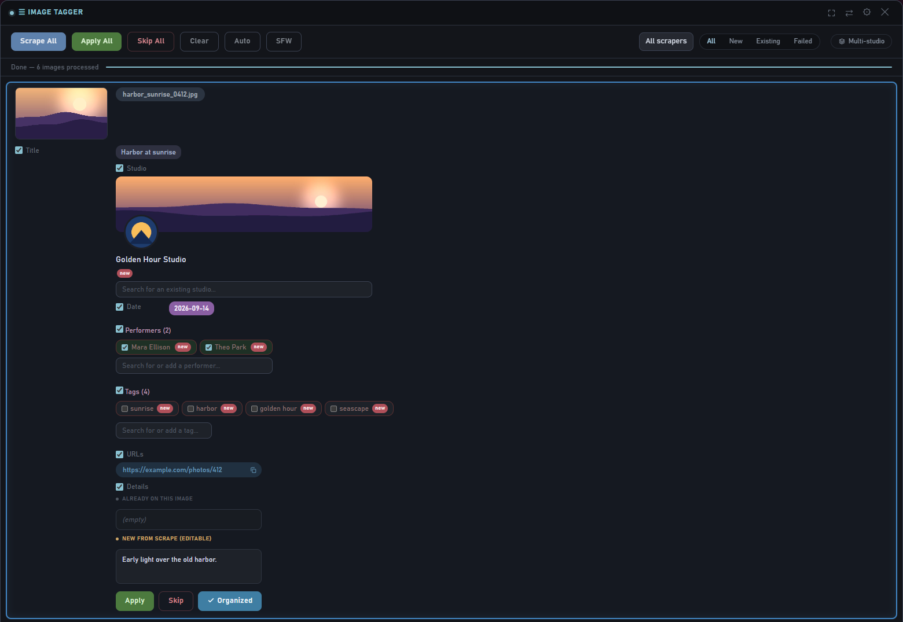
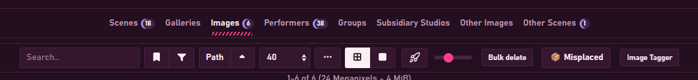
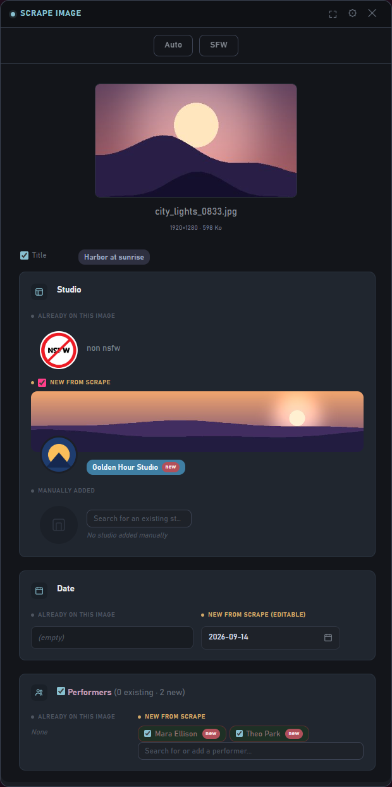
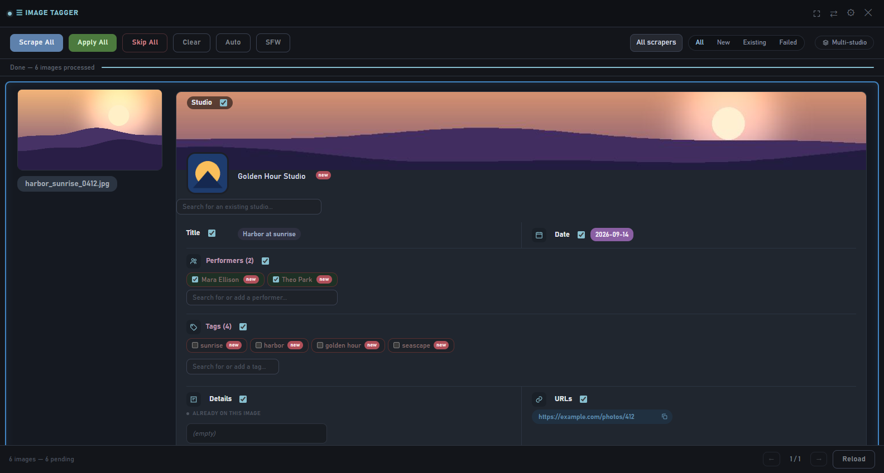
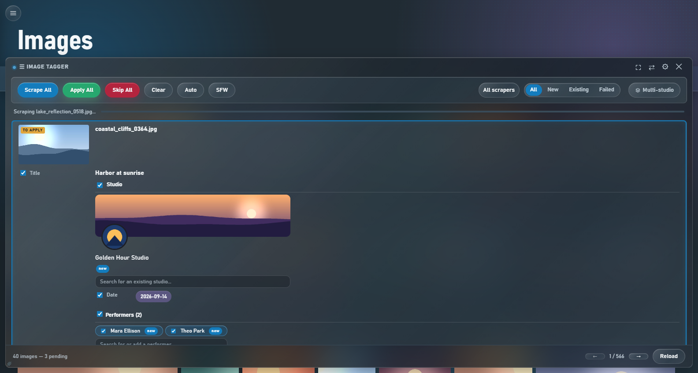
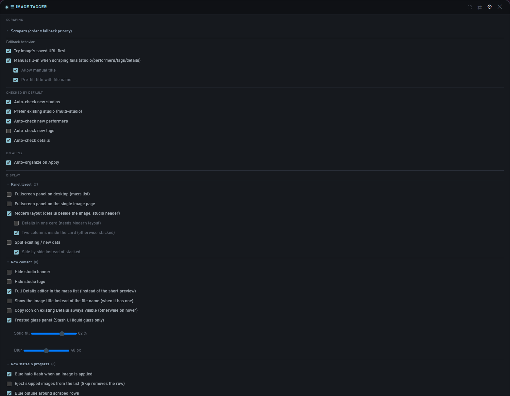

# Image Tagger

Bulk-scrape multiple Stash images in a row from a floating panel, review and
edit each proposed field before applying it, and move on to the next one
without reloading the page. Works on the `/images` list and on a single
image's page. JavaScript only - no backend, no dependencies.

## Why this plugin exists

Image Tagger was built in parallel with its sibling plugin,
[Scene Tagger](../sceneTagger). On the scene side there were already a few
mass-scrape solutions - not as polished as I wanted, but they existed. On the
image side I couldn't find much that worked directly and was ergonomic enough
to actually use on a large backlog: scrape a whole page of images, see what
each scraper found, fix what's wrong, apply, next. That gap is why this one
exists.

It shares its design with Scene Tagger (same panel, same review workflow, same
look), adapted to what images allow: scrapers go through Stash's
`scrapeSingleImage`, and there is a side-by-side comparison of the current
image and the scraped one in the single-image panel.

This is a personal tool, shared as-is because it turned out complete enough
to be useful to others - not actively maintained for every environment or
edge case, but it's held up well for daily use.

## Installation

1. In Stash: **Settings → Plugins → Add Source**, with the raw URL of this
   repo's `index.yml` file (e.g.
   `https://raw.githubusercontent.com/jojo-topo/stash-plugins/master/index.yml`).
2. Install **Image Tagger** from the list.
3. You need at least one scraper that supports images (Settings → Metadata
   Providers → Scrapers). Without one, there is nothing to scrape with.
4. Go to `/images`: an "Image Tagger" button appears in the toolbar. On an
   image's own page, a small **IT** badge appears in its toolbar.

## How to use it

### Bulk: the image list

1. Go to `/images` (or a studio's **Images** tab) and click the
   **Image Tagger** button in the toolbar.

   

2. Click **Scrape All** to run the configured scraper chain on every visible
   image, or **Scrape** on an individual row.
3. Review each result: uncheck anything you don't want, adjust the
   studio/performers/tags via the search boxes if needed.
4. Click **Apply** on a row (or **Apply All** once several rows are ready)
   to write the changes to Stash.
5. Use **Skip** to leave an image untouched and move on.

The **Auto / Manual** button in the panel header switches between running
the whole scraper chain and picking a single scraper yourself.

### One image: the IT badge

Open an image's page and click the **IT** badge in its toolbar. The same
panel opens for that one image and runs the scrapers on it. Apply, Skip and
**Organized** work like in the list. When the scraper returns an image, the
panel can show the **existing image next to the scraped one** so you can
check it's the right match before applying (option in Settings → Display).

## Features

### Bulk scraping with automatic fallback

Configure a chain of scrapers in order of priority (drag to reorder in
Settings). If the first scraper finds nothing for an image, the plugin
automatically tries the next one in the chain - no need to manually pick a
different scraper and retry. A small hint shows which scraper actually
matched when it wasn't the first one.

An optional toggle lets it try the image's already-saved URL
(`scrapeImageURL`) before the chain, useful when an image already carries a
source URL but hasn't been scraped yet.

### Review before applying - nothing happens silently

Each scraped image shows an inline, editable result: title, date, details,
URLs, performers, studio and tags. Every field has its own checkbox - uncheck
anything you don't want applied, edit the studio/performers/tags before
committing. Nothing is written to Stash until you click **Apply**.

### Existing vs new data, field by field

The existing data of an image is always kept when you apply. An optional
**Split existing / new data** layout (Settings → Display) shows **Already on
this image** next to **New from scrape**, stacked or side by side, so you see
exactly what will change. Fields with nothing to compare keep their compact
layout.

### Studio cards with logo and banner

The studio field shows a card: the studio's logo (round when it's roughly
square, rounded corners when it's wide) and, when the studio has one, a cover
banner with the logo overlapping it. It works for the scraped studio, for the
studio already on the image, and for any studio you pick through the search
box; clicking the logo opens the studio's page.

The banner is read from a `bg:<url>` line in the studio's **Details** (the
format used by the replaceBackground plugin). Studios without one simply show
their logo. When several studios are detected, hovering one in the list shows
its banner and logo. A logo with a transparent background is shown without
its dark frame. Both the banner and the logo can be hidden in Settings.

When a scraped studio matches a studio you already have that is missing its
logo or banner, the missing part is filled in on Apply - what is already
there is never overwritten.

### Search and create on the fly

Performers, studios, and tags all have a live search box built into the
panel - start typing to search the existing Stash database, or create a new
entry directly if nothing matches. No need to leave the panel or the page.

Performer results show a round avatar pulled from their existing Stash photo
when they already have one - hover it for a larger preview, handy for telling
apart similarly-named performers before committing to one.

### New-entity detection

Studios, performers, and tags not yet present in Stash are flagged with a
**new** badge. An option lets new entries be checked by default automatically
(handy for a first big import) or left unchecked for manual review
(safer when merging into an existing library).

Studio detection also checks **aliases**, not just the primary name - a
studio scraped under an alternate spelling won't be wrongly flagged as new
or create a duplicate.

### Mark as organized on Apply

Images can be marked as organized right when you apply. A global toggle
pre-checks it (only for images where a studio was actually matched - no result
or no studio stays unchecked, so you can still review those), and a per-image
**Organized** button overrides it manually.

### Multi-studio detail parsing

If an image's `details` field contains a line like
`Artists: name1[id1] | name2 | name3[id3]`, the plugin detects every
candidate and lets you pick the correct one via radio buttons - instead of
blindly taking whatever the scraper put in the `studio` field. This is a
convention specific to the
[rule34-python scraper](https://github.com/jojo-topo/stash-scrapers); with
any other scraper this simply doesn't trigger and the plugin falls back to
the scraper's own `studio` field.

### Studio blacklist

Maintain a list of studio names to ignore (useful for VA/compilation
channels that shouldn't become a "studio" entry) - candidates matching the
blacklist are skipped automatically unless they're the only option.

### Manual fallback when scraping fails

Optional setting: instead of a plain error message, a failed scrape shows
the same review panel - empty, ready to fill in studio/performers/tags/details
by hand. A **Retry** button stays available to attempt the automatic scrape
again. A further sub-option adds a manual title field, which can be
pre-filled with the file name (extension stripped). An image kept in this mode
keeps a red outline so it stays easy to spot.

### Persistent, non-disruptive panel

Changing page, filter, or sort on `/images` refreshes the list in place -
the panel never closes and reopens on its own, and rows already scraped in
this session keep their result if they're still in view.

### Live filtering after a bulk scrape

Once several images are scraped, filter the list by **All / New / Existing /
Failed** (whether the detected studio is new or already in your database, or
whether the scrape failed) and by which scraper actually matched, to quickly
focus on the images that need attention. Images you have already applied only
show up under the filters they belong to.

The **Multi-studio** button next to the filter cycles through three states
with one click each: off, only the images where several studios were detected
(blue), then everything except those images (red). An image you **Skip** stays
visible under All and under the filter it was skipped from (so you can undo
it there), and is hidden under the other filters. An option (**Eject skipped
images**) removes a skipped row from the list instead.

### Progress feedback while scraping

Each row being scraped is covered by a translucent progress veil with a status
line (which scraper of the chain is being tried, reading the URL, updating the
title). Stash gives no real percentage, so the veil is a simulated curve that
never claims to be done before the answer arrives. When the result comes in,
it fades into the scraped row. Scraped rows get a light blue tint and outline,
applied rows a softer blue, failed ones red. The veil, the status line, the
transition and the outline are four independent toggles (Settings → Display);
the transition is skipped when your system asks for reduced motion. A short
blue halo also flashes on a row when you apply it (option **Blue halo flash
when an image is applied**, on by default).

### Layouts: modern, one card, phones and tablets

- **Modern layout** puts the details beside the image with the studio banner
  as a header; **Details in one card** (with an optional two-column layout)
  builds on it.
- **Fullscreen panel on desktop** (mass list) and **Fullscreen panel on the
  single image page** are two separate options; the first is also reachable
  from a button in the title bar. Compact mode takes priority over fullscreen.
- On phones and tablets the panel goes fullscreen and the header folds with a
  chevron button (the state is remembered).
- The Display settings are collapsible sub-groups (open/closed state is
  remembered).
- An **SFW** button in the header blurs every image preview in the panel.

### Stash UI

If you use the Stash UI app, Image Tagger works there too: a toolbar button on
the images list opens the same panel, and the image viewer has a solo **IT**
button. The panel follows Stash UI's look (glass buttons, chips, readable
settings). This relies on the `assets/stashui.js` file shipped inside the
plugin package.

- Stash UI lists scroll without end, so the panel loads its own pages. Click
  the "N images" count at the bottom to change the **Images per page** value
  (5-200, default 40) in place, or set it in Settings.
- **Reload** starts from a clean list, as a page refresh would: applied,
  scraped and skipped rows are all dropped and the images are read again,
  without reloading the page.
- With Stash UI's liquid glass look on, **Frosted glass panel** makes the panel
  and its rows a more solid, more blurred glass; two sliders set the solid
  fill (40-100 %, default 82) and the blur (0-80 px, default 40).

## Settings

Open the gear icon on the panel header. Settings are grouped into
**Scraping**, **Checked by default**, **On apply** and **Display**:

- **Scraping** - the scraper chain (drag to reorder, toggle scrapers on/off;
  the block is collapsible), "Try image's saved URL first", manual fallback
  on scrape failure (+ manual title sub-option, + pre-fill with the file name)
- **Checked by default** - auto-check for new studios / performers / tags /
  details, prefer the existing studio
- **On apply** - auto-organize on Apply
- **Display** (all off by default unless noted)
  - Panel layout: fullscreen on desktop / on the single image page, Modern
    layout, Details in one card (+ two columns), Split existing / new data
    (+ side by side)
  - Row content: hide studio banner / logo, full Details editor in the list,
    show the image title instead of the file name (when it has one), copy
    icon always visible, frosted glass panel (+ solid fill and blur sliders,
    Stash UI only)
  - Row states and progress: blue halo flash on apply (on by default), eject
    skipped images, outline around scraped rows, progress veil, status line,
    smooth transition
  - Single image panel: show the existing and scraped images side by side
  - Stash integration: images per page (Stash UI only), hide the Auto/Manual
    toggle on the image page, hide the **IT** button on the image page
- The settings panel itself can be resized: drag the bar at its bottom edge,
  double-click it to reset.

### Compact mode

A separate button in the panel's title bar (not in the settings menu above)
toggles a compact floating panel mode - a smaller, draggable window docked to
a corner instead of the full-width bar, for when the full panel takes up too
much space. The layout options above apply to the regular panel, not to
compact mode.

## Known limitations

- Mainly tested on a recent Stash version (v0.31.x) - not guaranteed on
  older versions.
- There is no "Search title": Stash's `scrapeSingleImage` can't search by
  name, so an image no scraper recognises goes to the manual fallback instead.
- There is no cover picker or hover video preview: those make no sense for
  images.
- Studio banners need a `bg:<url>` line in the studio's Details; without it
  only the logo is shown.
- Stash UI support needs the `assets/stashui.js` module from the plugin
  package (installed automatically with the plugin).

## License

MIT
